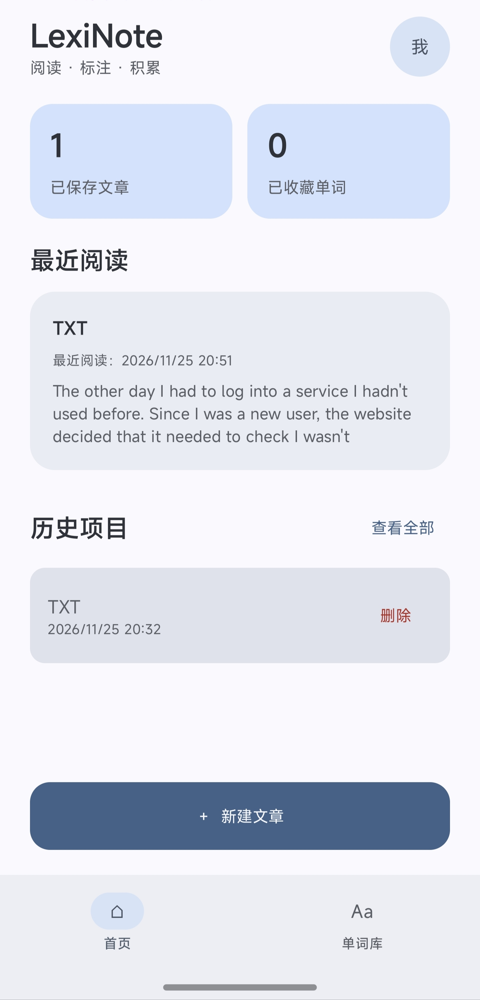
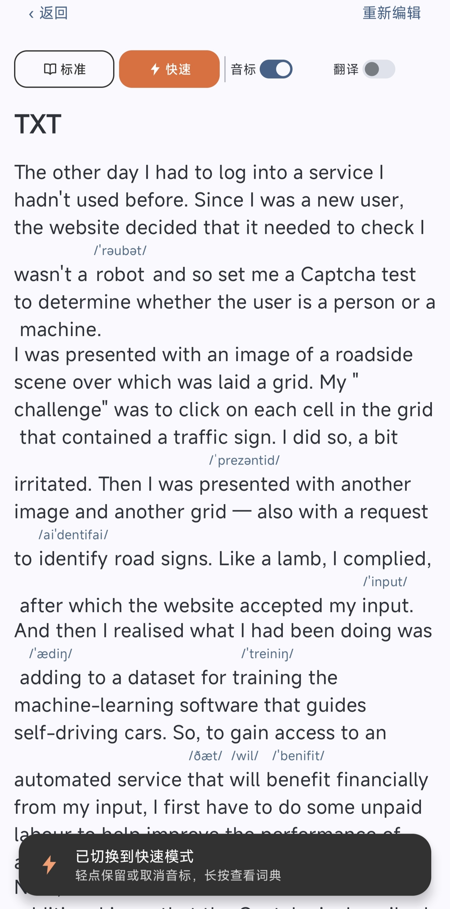
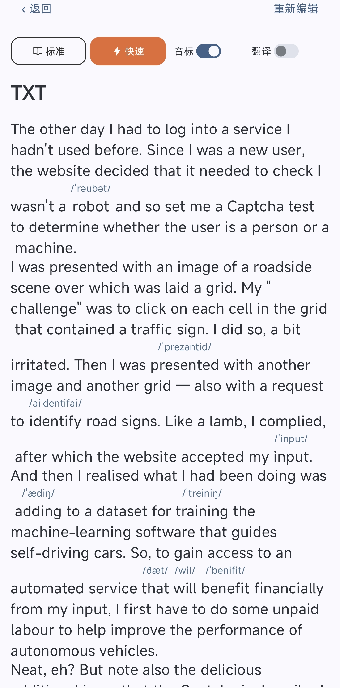
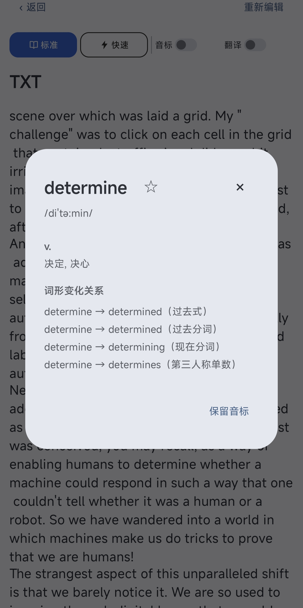
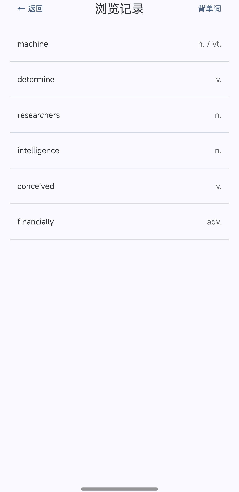

# LexiNote

**一款面向大学生英语演讲和文章阅读的轻量化查词、音标标注工具。**

**Offline English Reading & Phonetic Annotation App**

## 下载 Android APK

**最新公开测试版：v0.3.6**

[前往 Gitee Release 下载 Android APK](https://gitee.com/zephyrmiao133/lexinote/releases)

在 Release 页面下载 `app-release.apk`，即可在 Android 手机上安装使用，无需 Android Studio。

## 设计初衷

大学生准备英文 Presentation 时，常常已经写好了演讲稿，却发现里面有不少不会读或不认识的单词。

传统查词方式需要反复选中单词、复制、切换词典应用、粘贴查询，再把音标整理回演讲稿。处理整篇文章时，这些重复操作会打断阅读和准备过程。

LexiNote 希望让这件事更简单：**点击单词即可查词，也可以直接将音标保留在原文中，方便继续阅读、朗读和复习。**

## 主要功能

- **标准模式：** 点击单词查看离线词典详情，包括音标、词性、中文释义和词形信息。
- **快速模式：** 点击单词即可添加或取消该词的音标标注。
- **原文音标标注：** 将音标显示在对应英文单词上方，阅读器以音标、原文、译文三行排版。
- **离线词典：** 使用本地词典查询已收录词汇，并查询英语词形变化。
- **生词管理：** 收藏单词、查看浏览记录，并在生词库中复习。
- **文章管理：** 创建、编辑、阅读和保存英文文章。

## 软件截图

以下为 LexiNote 当前版本的实际界面截图。

### 首页

首页展示已保存文章数量、收藏单词数量、最近阅读和历史项目入口，也可从此处新建文章。



### 阅读器与音标标注

阅读器提供标准查词模式和快速音标模式。标准模式点击单词打开词典卡片；快速模式点击单词即可保留或取消音标。已添加的音标显示在原文对应单词上方。

| 标准模式 | 快速模式 |
| --- | --- |
|  |  |



### 查词与词汇管理

词典卡片展示单词音标、词性、释义和词形变化，并提供收藏及保留音标的操作。词库页面可查看浏览记录，并切换到背单词列表。

| 单词查阅卡片 | 单词库列表 |
| --- | --- |
|  |  |

## 安装与使用

从上方 Gitee Release 页面下载 `app-release.apk`，在 Android 手机上打开安装包并按系统提示完成安装。安装 APK 不需要 Android Studio。当前项目最低 Android 版本为 Android 8.0（API 26）。

创建或打开文章后，可在标准模式点击单词查看词典详情；切换到快速模式后，点击单词即可添加或取消音标。收藏的词汇可在生词库中查看和复习。

## 技术栈

- Kotlin
- Android Jetpack Compose / Material 3
- AndroidX Lifecycle、ViewModel、Kotlin Coroutines / Flow
- Room 与 SQLite 本地存储，KSP
- JUnit、AndroidX Instrumentation / UI 测试依赖

## 开发与构建

使用 Android Studio 打开仓库中的 `android/` 工程，并配置兼容的 Android SDK、JDK 与 Android Gradle Plugin 环境。可在 Android Studio 同步 Gradle 后运行 `app` 配置。

Gradle Wrapper 使用官方 Gradle 9.6.0 分发地址：`https://services.gradle.org/distributions/gradle-9.6.0-bin.zip`。请按项目配置准备兼容的 JDK 和 Android SDK；项目尚未在其他开发环境验证构建。

## 项目结构

```text
.
├── android/                   # Android Studio 工程
│   └── app/src/main/
│       ├── assets/             # 离线词典及第三方数据声明
│       └── java/com/lexinote/  # Kotlin 应用源码
├── docs/screenshots/           # 软件截图（待补充）
├── CHANGELOG.md                # 阶段开发记录
├── LICENSE                     # 项目原创代码许可证
└── THIRD_PARTY_NOTICES.md      # 第三方数据详细声明
```

## 后续规划

- 支持 TXT、Markdown 和 Word 文档导入。
- 探索结合上下文的词义分析。
- 增加更丰富的阅读注释方式。

以上为后续计划，尚未实现。

## 开源许可证与第三方词典

项目自有且有权授权的原创程序代码采用 MIT License，详见 [LICENSE](LICENSE)。第三方词典数据遵循各自许可：

- ECDICT：[https://github.com/skywind3000/ECDICT](https://github.com/skywind3000/ECDICT)（MIT License）
- UniMorph English：[https://github.com/unimorph/eng](https://github.com/unimorph/eng)（CC BY-SA 3.0）

第三方数据的来源、修改说明、版权通知和再分发条件请参阅 [THIRD_PARTY_NOTICES.md](THIRD_PARTY_NOTICES.md)。项目代码的 MIT 许可不替代第三方数据许可。

## 贡献与问题反馈

欢迎在 [Gitee Issues](https://gitee.com/zephyrmiao133/lexinote/issues) 反馈问题、提出建议或讨论贡献。提交贡献前，请说明变更内容并确认提交内容具备相应授权。
